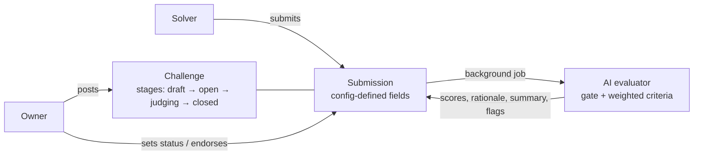

# Open Challenge Platform

**A config-driven, open-source innovation challenge platform template.**
Someone posts a problem. Others submit solutions. AI evaluates every
submission against your rubric. The owner endorses the best.

Use one codebase for an **open innovation** program, a **hackathon platform**,
a **problem-solution marketplace**, a civic problem hub, a research bounty
board, an internal idea programme or a grant call. Terminology, roles, form
fields, stages, statuses, the AI evaluation rubric and prompt, branding and
sign-up rules all come from **one config file**. Built as a **Next.js template**
with Drizzle ORM and MySQL, with pluggable **AI evaluation** (Gemini by default).

<!-- Screenshots: add images to docs/screenshots/ and reference them here.


-->
> _Screenshots coming soon._

---

## The flow



1. **Owners** (Host / Official / Sponsor, whatever you call them) post
   **challenges**. A challenge has a markdown description, a category,
   reward, deadline and any extra fields you define.
2. **Solvers** submit **solutions** through a form generated from your config.
3. An **AI evaluator** scores each one in the background. It applies an
   optional pass/fail gate, then integer scores per criterion with rationales.
   Those combine into a weighted 0-100 overall score, plus a summary and flags.
4. Owners review, move submissions through your **statuses** (shortlisted,
   winner...) and **endorse** the ones they will take forward. Everyone involved
   gets in-app notifications.

### What you get

- Challenge listing with search and filters, detail pages, and a submit flow.
- Submission pages with an AI score panel, upvotes, endorsements with notes,
  owner review controls and a "re-run evaluation" button.
- Dashboards for owners (review queue, my challenges) and solvers (my submissions).
- A leaderboard, notifications, and profiles with role-specific fields.
- An admin panel: approve owners, change roles, feature challenges and run pending evaluations.
- Email/password auth (scrypt + signed JWT cookie), owner approval, and email-domain allow-lists.
- AI providers: **Gemini** (AI Studio or Vertex), **any OpenAI-compatible API**
  (OpenAI, OpenRouter, Groq, Ollama...) and a **mock** provider that needs no key.
- Retries through a cron endpoint and a CLI, a health check, Railway config and a Dockerfile.

## Quick start (local)

Requirements: Node.js 20.9+ and Docker (for MySQL). Any MySQL 8 or MariaDB 10.6+ works.

```bash
git clone <this repo> && cd open-challenge-platform
npm install
cp .env.example .env.local        # defaults work for local dev (AI_PROVIDER=mock)
docker compose up -d              # MySQL on localhost:3306
npm run db:migrate                # create tables
npm run db:seed                   # fictional demo data + mock AI scores
npm run dev                       # http://localhost:3000
```

The login page lists the demo accounts in development. They all use the
password `demo-password`. The admin is whatever you set in `SEED_ADMIN_EMAIL`
and `SEED_ADMIN_PASSWORD`.

**Try another use case:** set `NEXT_PUBLIC_PLATFORM_PRESET=civic` (or
`corporate`, `research`) in `.env.local`. Then run
`npm run db:seed -- --reset` and restart `npm run dev`.

**Use a real model:** set `AI_PROVIDER=gemini` and `GEMINI_API_KEY=...`. Then
run `npm run db:seed -- --reset --ai` or submit something.

| script | |
| --- | --- |
| `npm run dev` / `build` / `start` | Next.js |
| `npm run lint` / `typecheck` | ESLint / `tsc --noEmit` |
| `npm run config:check` | Validate all presets. `-- --prompt` prints the AI prompt, `-- --score` runs the mock end-to-end |
| `npm run db:generate` / `db:migrate` / `db:push` | Drizzle migrations |
| `npm run db:seed [-- --reset] [-- --ai]` | Demo data for the active preset |
| `npm run eval:pending` | Evaluate pending and failed submissions now |

## Configure your own use case

Edit **`platform.config.ts`**. Full reference: **[docs/CONFIGURATION.md](docs/CONFIGURATION.md)**.

```ts
export default defineConfig({
  id: "custom",
  branding: { name: "Greenfield Challenges", primaryColor: "#16a34a", hero: { ... }, ... },
  terminology: {
    challenge: { singular: "Challenge", plural: "Challenges" },
    submission: { singular: "Solution", plural: "Solutions" },
    endorsement: { verb: "Endorse", past: "Endorsed", noun: "Endorsement" },
    ...
  },
  roles: { owner: { label: "Host", ... }, solver: { label: "Solver", ... } },
  permissions: { createChallenge: ["owner", "admin"], submit: ["solver"], endorse: "challenge-owner" },
  challenge: { stages: [...], defaultStage: "open", fields: [...] },
  submission: { fields: [{ key: "repo_url", label: "Repository", type: "url", required: true }], statuses: [...] },
  evaluation: {
    persona: "You are an experienced, fair judge ...",
    gate: { label: "Relevance check", question: "Is this a genuine attempt ...?" },
    criteria: [
      { key: "impact", label: "Impact", description: "...", weight: 3 },
      { key: "feasibility", label: "Feasibility", description: "...", weight: 2, min: 1, max: 5 },
    ],
  },
});
```

Custom fields are stored as JSON, so changing the config needs **no database
migration**. Three complete examples ship with the repo, all with fictional demo data:

| preset | what it is | interesting bits |
| --- | --- | --- |
| `custom` (`platform.config.ts`) | General open innovation / hackathon | Public scores, leaderboard, team fields |
| `civic` | City officials post local problems, residents propose solutions | Owner approval, "any official can champion", private contact field, 1-9 readiness scale with anchors |
| `corporate` | Internal innovation challenge at a fictional company | Sponsors can also pitch, scores visible only to the author and sponsor, draft-first stages |
| `research` | Research problem bounty board | Private submissions, 0-10 scales, rigour gate, no upvotes or leaderboard, no edits after submit |

## Deploy

Generic notes plus Railway, Vercel and Docker: **[docs/DEPLOYMENT.md](docs/DEPLOYMENT.md)**.
In short: a MySQL database, the env vars from `.env.example`, `npm run db:migrate`
on deploy, and a scheduler calling `GET /api/cron/evaluate` with `Authorization: Bearer $CRON_SECRET`.

## AI providers

Gemini is the default. Any OpenAI-compatible endpoint and a mock are built in.
Adding another provider means implementing one method. See
**[docs/AI_PROVIDERS.md](docs/AI_PROVIDERS.md)**.

## Project layout

```
platform.config.ts          ← the config you edit (+ platform.seed.ts demo data)
src/config/                 schema.ts (zod, source of truth), presets/, loader
src/lib/ai/                 provider interface, gemini / openai-compatible / mock, prompt builder, scoring
src/lib/db/schema.ts        Drizzle schema (users, challenges, submissions, endorsements, upvotes, notifications)
src/lib/permissions.ts      every "who can do what" rule
src/lib/fields.ts           config fields → zod validation / form parsing
src/app/                    Next.js App Router pages and server actions
scripts/                    seed, evaluate-pending, check-config
drizzle/                    SQL migrations
```

## Status and limitations

This is a template, so expect to adapt it. Not included yet: file uploads,
email notifications, OAuth/SSO, comments or Q&A threads, multi-round judging
with human judge panels, and i18n beyond labels.

## Licence

No licence has been chosen yet. Until one is added, all rights are reserved by
the author.
